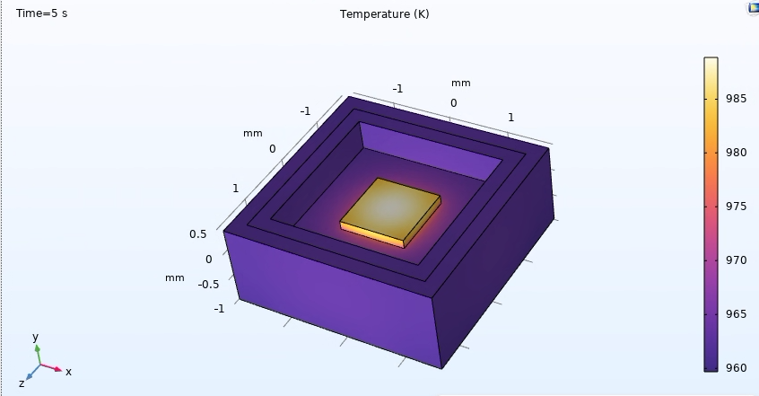
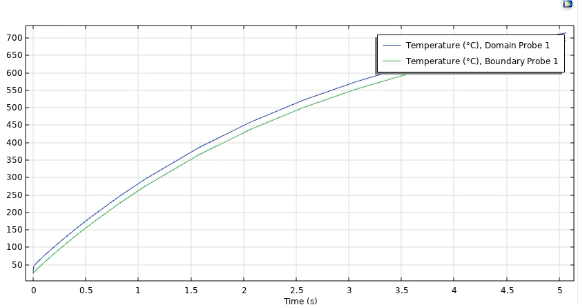

# LED cooling — progress log

A running log of the work on the LED cooling investigation: what I did, what I found, what's next, and the sources I used. One entry per work session. The rule for this log is simple — it records actual work, not plans. If it's not done, it doesn't go in the "did" column.

Repo: https://github.com/Qaliss/ReddyLabResearch
- `Circuit/` — brightness control (rheostat dimmer, PWM exploration, diode model)
- `Thermal/` — 1-D MATLAB thermal model, datasheets, COMSOL setup

## Current status — Nov 12, 2026

**Done**
- 1-D MATLAB thermal model, self-consistent (validated Nov 6): the FR4 board conduction path is the bottleneck — board path 136.4 °C/W (6× 0.2 mm vias) / 47.8 °C/W (18 vias) vs ~2.8 °C/W available. Required heatsink resistance is negative (−134.05 / −45.03 °C/W), so no heatsink alone fixes it.
- Brightness-control skill-builder: a rheostat dimmer, plus a PWM test (blink, dimmer, sinusoid sketches).
- PWM exploration: blink, dimmer, sinusoid-mapping sketches. PWM is a starting point for brightness tracking, not acceptable for the final driver.
- Diode model: Lambert W current calculation (n = 1.75), with the valid resistor range for a 2–5 mA window.
- COMSOL Multiphysics 6.4 (lab machine, remote login): transient materials table filled in (density + heat capacity for every stack material).
- CAD: simplified SolidWorks model of the UV LED built, material properties assigned, uploaded to the repo with the datasheet.
- COMSOL transient baseline: bare LED alone at max power (11.201 W, h=10 convective flux) — just keeps heating, no heatsink or PCB below it.

**In progress**
- COMSOL transient run — bare-LED baseline done Nov 12 (crosses 125 °C in ~0.3 s, ~715 °C at 5 s). Next: FR4 PCB, then vias, then MCPCB/copper substrate.

**Open questions**
- PCB size for the next board revision — sets the TIM contact area and the spreading area in the model.
- Acceptable steady-state junction temperature — being looked into.
- Copper-substrate vs aluminum-core MCPCB — copper-substrate boards are apparently strongly recommended for this LED series; comparing the two for our case.
- Area to use for the board path: the 1-D model uses a 4 mm² footprint area; the datasheet package is 3.5 × 3.5 mm (12.25 mm²). Running the MCPCB chain at both.

## Log

### Nov 12
- **Did:** Ran a COMSOL transient study of the bare LED alone at max power (11.201 W), outer faces with convective flux h=10 W/m²K — no heatsink or PCB below it.
- **Found:** The bare LED at max power just keeps heating up — crosses 125 °C in ~0.3 s, ~715 °C at 5 s and still rising. The heat has nowhere to go without a board or heatsink underneath.
- **Next:** Add different PCB types (FR4, FR4 with vias, MCPCB/copper substrate) and run time-dependent studies to compare.

### Nov 11
- **Did:** Uploaded the simplified SolidWorks LED CAD model and the datasheet to the repo. Asked about copper-substrate vs aluminum-core MCPCB and the PCB size for the next revision.
- **Found:** Copper-substrate PCBs are distinct from aluminum-core metal-core boards, and apparently strongly recommended for this LED series.
- **Next:** MCPCB math on paper (both areas), then the COMSOL transient run Sat Nov 14.
- **Sources:** Luminus SBT-10X-UV datasheet PDS-003047 Rev 03.

### Nov 10
- **Did:** Built the simplified SolidWorks CAD model of the UV LED for COMSOL import; assigned material properties. Set the sequence: FR4 with no heatsink → MCPCB math on paper → COMSOL with MCPCB + convection.
- **Found:** Two traps for the MCPCB math. (1) The 1-D model's 4 mm² area vs the 12.25 mm² datasheet package — R = t/(k·A), so a ~3× area difference flips the verdict. (2) The TIM term must be recomputed at the heatsink-base contact area on an MCPCB, not the LED footprint (0.03 °C/W over a 20×20 mm base vs 3.125 °C/W at the footprint). Also: air convection at this scale is laminar flow — the Rayleigh number is well below the turbulent transition.
- **Next:** MCPCB chain on paper at both areas; COMSOL run.
- **Sources:** SBT-10X-UV datasheet; JLCPCB / BestPCBs / Andwin MCPCB guides (dielectric 50–150 µm, k 1–3 standard; Al base 1.0–3.2 mm, k 150–235; Cu base k 380–400).

### Nov 8–9
- **Did:** Filled in the COMSOL transient materials table (ρ and Cp for copper, aluminum, solder, FR4, TIM grease, LED die). Moved from 1-D calculations to figuring out 3-D heat transfer in simulation.
- **Found:** The 1-D chain misses entire mechanisms — in 3-D the air moves, and the transient question (how long until thermal failure) needs the full model. Learning buoyancy forces, Rayleigh number, Prandtl number, and flow regimes to model it.
- **Next:** Materials into COMSOL, Heat Sink tutorial, reproduce-first run.
- **Sources:** COMSOL Learning Center; Heat Sink tutorial; LED Bulb Cooling model.

### Nov 7
- **Did:** Switched the 3-D work to COMSOL Multiphysics 6.4 (no ANSYS available — COMSOL is on the lab machines, accessed by remote login). Wrote a setup sheet and validation targets for the reproduce-first run.
- **Found:** The reproduce-first case is 395 nm, 4.1 V, 4.0 A, P_heat 11.201 W — if COMSOL gives a comfortable positive heatsink number with the FR4 stack, the setup is wrong.
- **Next:** Materials table, then the tutorial, then the reproduce run.
- **Sources:** COMSOL Learning Center (Getting Started); Heat Sink tutorial (Application Library); LED Bulb Cooling model.

### Nov 6
- **Did:** Debugged the MATLAB vias model until self-consistent — fixed three unit bugs (power 100× too big, menu index used as thickness, TIM mm vs m²). Sent the thermal work for review. Wrote READMEs for the Thermal and Circuit folders; pushed to the repo (commit 9fa0a83).
- **Found:** At 395 nm (4.1 V, 4.0 A, P_heat 11.201 W), 1.6 mm board, grease TIM: board path 136.4 °C/W with 6× 0.2 mm vias, 47.8 with 18 — vs ~2.8 available. Vias alone won't close it. Levers: copper-filled vias (~7× per via), thinner board, copper pour/spreading, metal-core board, derating, direct attach. Also confirmed: the prototype is a single LED on one PCB (not an array, so no array sweep), and the via stack runs through the board to another copper surface where the heatsink attaches. Forced convection would only help the heatsink side, not the FR4 board path.
- **Next:** 3-D model to show the spreading the 1-D calc misses.
- **Sources:** Luminus datasheet (Tjmax 125 °C; Rθj-c 1.8 electrical / 2.6 real °C/W at 3 A; WPE 31.7%).

### Nov 5
- **Did:** Planned the 3-D steady-state thermal analysis of the LED to design heatsinks and TIM — parametric and scalable for multiple LEDs and different wavelengths, designed to the worst case.
- **Next:** Pick the tool (became COMSOL Nov 7).

### Nov 3–4
- **Did:** Pinned a thermal-model reading list: datasheet first, then the board path, then heatsink and fan sizing. Wrote a fill-in check sheet for the FR4 calc — reconcile Tjmax first (125 °C datasheet vs 145 °C the early model used), then the spreading check and the via-fill check, then rebuild the series chain, with Vf-as-thermometer validation at the end.
- **Sources:** SBT-10X-UV datasheet.

### Oct 25
- **Did:** PWM exploration on the bench: blink, dimmer, sinusoid-mapping sketches, saved to the repo.
- **Found:** PWM works for brightness tracking as a starting point, but is not acceptable for the final driver circuit.
- **Next:** Non-PWM brightness control approaches.

### Oct 22–23
- **Did:** Built the 1-D MATLAB thermal model of the LED cooling path.
- **Found:** The required heatsink resistance comes out negative — the FR4 board itself is the bottleneck, and no heatsink fixes that. (Early version used Tjmax 145 °C; the datasheet says 125 °C — reconciled later.)
- **Next:** Extend the model for vias + TIM and debug it against the datasheet.
- **Sources:** Luminus SBT-10X-UV datasheet.

### Oct 19
- **Did:** Took on the LED cooling investigation — a real open problem: how to keep the LED cool enough to run stably.
- **Next:** Build the 1-D model.

### Oct 9–19
- **Did:** Brightness-control skill-builder: a rheostat dimmer.
- **Found:** The dimmer works — simple, direct brightness control from a potentiometer. PWM (tested Oct 25) is the alternative for tracking brightness, but not acceptable for the final driver circuit.
- **Next:** Cooling investigation.

## Sources and references
- Luminus SBT-10X-UV datasheet, PDS-003047 Rev 03 (2024) — https://www.mouser.cl/datasheet/2/245/Luminus_SBT_10X_UV_Datasheet-3367663.pdf
- COMSOL Learning Center — https://www.comsol.com/support/learning-center/
- COMSOL Heat Sink tutorial — https://www.comsol.com/model/download/1070081/models.heat.heat_sink.pdf
- COMSOL LED Bulb Cooling model — https://translation-ru.comsol.com/model/download/1374581/models.heat.led_bulb.pdf
- JLCPCB metal-core PCB guide — https://JLCpcb.com/blog/metal-core-pcb-thermal-conductivity-design-guide
- BestPCBs metal-core material guide — https://www.bestpcbs.com/blog/2026/03/metal-core-pcb-material-mcpcb/
- Andwin MCPCB design guide — https://www.andwinpcb.com/metal-core-pcb-in-power-electronics-igbt-mosfet-and-rectifier-applications/

## How to add a day (template)

### [Date]
- **Did:** (what I actually did — concrete, verifiable)
- **Found:** (what I learned, or what the numbers said)
- **Next:** (the next concrete step)
- **Sources:** (datasheets, tutorials, pages I read)

